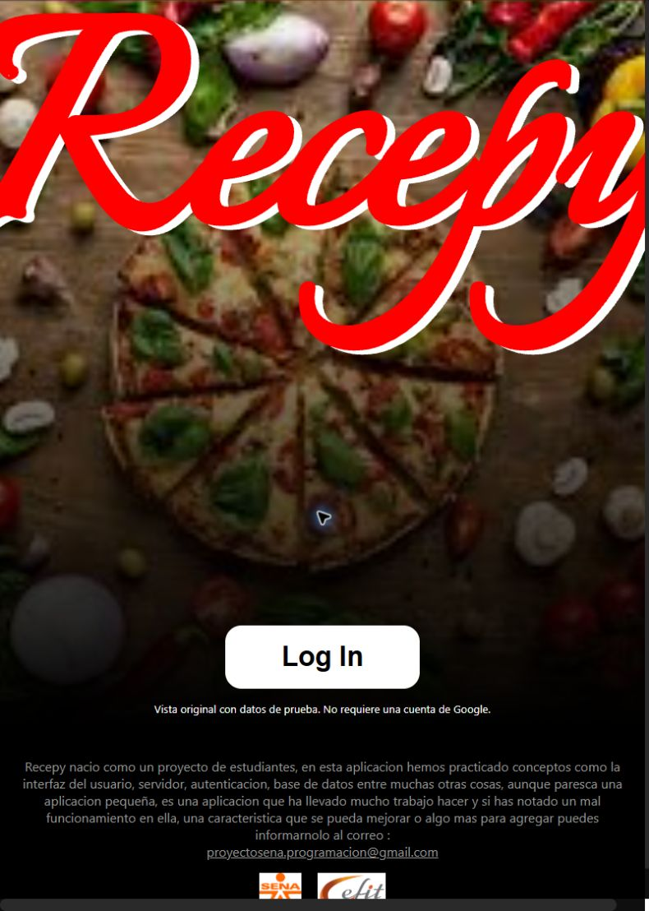
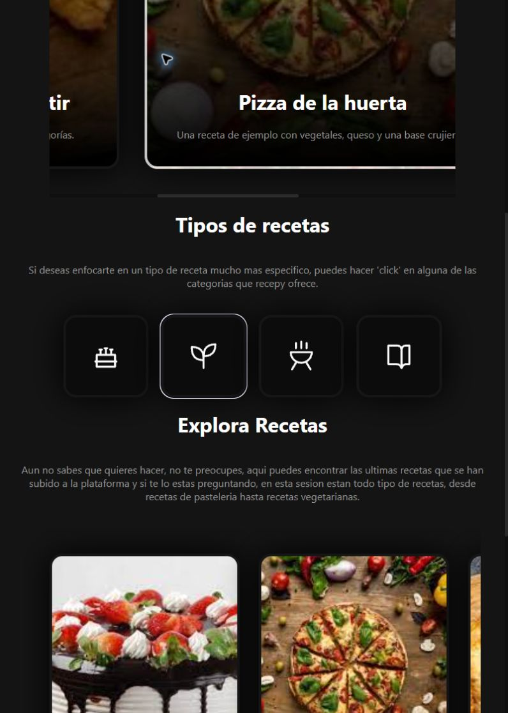

# Recepy

Una pequeña red social para compartir recetas, nacida como proyecto estudiantil en 2021 y recuperada para conservar su historia y volver a explorarla desde un entorno actual.

Recepy reúne un catálogo de recetas, categorías de cocina, fichas con ingredientes y preparación, y un formulario para compartir nuevas ideas. La rama `main` recupera los estilos y la composición de la última interfaz publicada en 2021, con una sesión y datos de demostración que permiten recorrerla sin las cuentas ni los servicios originales.



## Qué puedes explorar

- Portada fotográfica con el nombre Recepy en cursiva roja y acceso mediante el botón `Log In`.
- Interior gris oscuro, controles superiores, categorías y carruseles horizontales de recetas.
- Recetas con nombre, autor, descripción, ingredientes, preparación, imagen y un enlace de video opcional.
- Categorías de pastelería, cocina vegetariana, parrilla y otras recetas.
- Una selección de tres recetas destacadas. Se ordenan por nombre; no representan un ranking de popularidad.
- Fichas de detalle, navegación entre categorías y perfil de demostración.
- Publicación de recetas de prueba en el navegador, con validación y mensajes de error.
- Vista **Mis recetas** para consultar lo que guardaste en este navegador; es una adaptación de la demo, no un componente original recuperado.



Las capturas muestran la restauración actual. Las recetas de ejemplo se prepararon para esta demostración: **no son datos recuperados de los usuarios de 2021**.

## La interfaz de 2021

La portada recupera la fotografía `wallpaper.jpg`, el degradado a negro y la marca roja en **Italianno**, con el tamaño original de `40vh` y sombra blanca. El interior vuelve al fondo `#141414`, las superficies `#1e1e1e`, la tipografía del sistema y las tarjetas redondeadas del código histórico.

Italianno se incluye localmente desde el [repositorio oficial de Google Fonts](https://github.com/google/fonts/tree/main/ofl/italianno), con su [licencia SIL OFL 1.1](public/fonts/italianno/OFL.txt). Se registra en la cabecera para corregir el orden del import remoto durante la compilación, sin cambiar las reglas visuales históricas.

Se mantienen los carruseles horizontales y los modales que se abren mediante fragmentos de URL y selectores CSS `:target`. Las transiciones de interacción duran `333ms`. Las apariciones de Framer Motion conservan los retardos históricos y `duration: 0`: son apariciones escalonadas, no una nueva animación suave de escala.

La recuperación adapta los datos, la sesión y las comprobaciones necesarias para ejecutar el recorrido. La primera demo, que utilizaba una composición visual diferente, se conserva en la rama `demo-modernizada`; la referencia para la presentación de `main` es el árbol `original-2021`.

## Dos formas de ejecutar el proyecto

| Modo                   | Qué permite                                                                | Qué necesita                                                                    |
| ---------------------- | -------------------------------------------------------------------------- | ------------------------------------------------------------------------------- |
| `demo`, predeterminado | Explorar ejemplos y guardar recetas de prueba en `localStorage`            | Un navegador; no requiere credenciales ni servicios externos                    |
| `firebase`             | Consultar una colección `recipes` y usar el acceso opcional mediante Auth0 | Configuración propia de Firebase y Auth0, además de reglas y permisos adecuados |

En la demo, tus recetas permanecen en el almacenamiento de ese navegador y origen. No se comparten con otros visitantes ni se envían a una base de datos. Puedes limpiar las recetas locales desde la vista Mis recetas; borrar los datos del navegador también las elimina. Las imágenes admiten hasta 1 MiB y el video es una URL web opcional, no una subida de archivo. El espacio disponible depende del navegador y existe un límite adicional para la información guardada por la demo.

Para probar el recorrido, pulsa `Log In` en la portada: en modo demo entra directamente, sin Google ni registro externo. Desde el interior puedes abrir el perfil superior, agregar una receta y consultar **Mis recetas** en `/home/mis-recetas`. Esa vista usa los estilos históricos de `GetUser.module.scss` para presentar únicamente tus publicaciones locales.

El modo Firebase de esta recuperación es de **solo lectura**. Publicar en la nube requiere implementar un backend que valide la identidad de Auth0 y autorice las operaciones en Firebase. Iniciar sesión en Auth0 no concede permisos en Firestore o Storage por sí solo.

Consulta [la guía de configuración](docs/CONFIGURACION.md) para activar cada modo y entender sus límites.

Las pruebas y el recorrido comprobado en el navegador están descritos en [VALIDACION.md](docs/VALIDACION.md).

## Ejecutar en local

Requiere **Node.js 22.13.0 o posterior** y npm. El entorno utilizado durante la recuperación fue Node.js 24.19.0.

```bash
git clone https://github.com/own21m/recepy.git
cd recepy
npm ci
npm run dev
```

Abre [http://localhost:3000](http://localhost:3000). La demo funciona sin crear un archivo de entorno. Si quieres declarar la configuración explícitamente, copia `.env.example` como `.env.local` y conserva `NEXT_PUBLIC_DATA_MODE=demo`.

Para comprobar la compilación y ejecutar su resultado:

```bash
npm run build
npm start
```

Detén el servidor con `Ctrl+C`. Los servidores locales se enlazan a `127.0.0.1`.

## Comprobaciones y formato

```bash
npm run lint
npm test
npm run format:check
npm run build
```

`npm test` ejecuta las pruebas de la lógica compartida mediante el runner de Node.js. La compilación comprueba las rutas y componentes con Next.js. Estas comprobaciones no sustituyen una prueba de integración con cuentas reales de Auth0 y Firebase.

El código fuente está organizado y sin minificar, con comentarios que explican las responsabilidades y decisiones relevantes. Para aplicar el formato configurado:

```bash
npm run format
```

Next.js genera sus propios archivos de compilación en `.next`; esos archivos y `node_modules` no forman parte del código que se conserva en el repositorio.

## Tecnologías

| Responsabilidad     | Proyecto de 2021             | Versión recuperada                                   |
| ------------------- | ---------------------------- | ---------------------------------------------------- |
| Aplicación y rutas  | Next.js 11.1.2, Pages Router | Next.js 16.4.3, Pages Router                         |
| Interfaz            | React 17.0.2                 | React y React DOM 19.3.1                             |
| Estilos             | Sass y CSS Modules           | Sass 1.106.1 y CSS Modules                           |
| Animación           | Framer Motion 4              | Framer Motion 14.6.0                                 |
| Formularios         | Formik 2                     | Formik 2.4.9                                         |
| Datos e integración | Firebase 9                   | Firebase 13.1.0; integración opcional de lectura     |
| Acceso              | Auth0 React 1                | Auth0 React 2.28.2; configuración propia opcional    |
| Calidad             | ESLint 7                     | ESLint 10.13.0, Prettier 3.9.10 y pruebas de Node.js |

Las versiones exactas están fijadas en [package.json](package.json) y `package-lock.json`. Se actualizaron las dependencias para poder recuperar el proyecto con herramientas actuales; no se presenta la infraestructura de 2021 como un servicio activo.

## Organización

```text
components/
  auth/           Sesión, acceso y perfil de demostración o Auth0
  content/        Contenido principal y pie de página
  database/       Catálogo, categorías, formulario y proveedor de recetas
docs/             Configuración, recuperación y capturas locales
lib/              Contrato de recetas, validación y persistencia de la demo
pages/            Portada, catálogo, categorías y vista de mis recetas
public/           Recursos visuales conservados del proyecto original
styles/           Estilos Sass organizados por componente
tests/            Pruebas de la lógica de recetas
```

## Historia y recuperación

El proyecto original fue desarrollado por estudiantes del **Cefit**, en el contexto de su formación vinculada al **SENA**:

- Juan Pablo Gutierrez Gutierrez.
- Esteban Perez Garzon.
- Cristian David Ramirez Vargas.

Esta publicación conserva el carácter colaborativo de aquella obra y su historial de Git. La recuperación en la cuenta `own21m` parte de [gautierrgautier/application](https://github.com/gautierrgautier/application); el repositorio de origen se mantiene.

Se compararon las cuatro versiones históricas encontradas. `application` era la más completa, aunque sus últimos despliegues habían fallado. Se identificaron rutas de importación rotas y problemas de carga de recetas. La recuperación combina la interfaz gris original con una demostración independiente de las cuentas antiguas. Los detalles, hashes y evidencias están en [Recuperación del proyecto](docs/RECUPERACION.md).

Las referencias `original-2021` y `ultimo-despliegue-2021` permiten consultar, respectivamente, el último árbol original y la revisión cuyo último despliegue satisfactorio quedó registrado. No se restauraron las cuentas de Vercel, Auth0 o Firebase, ni se recuperaron usuarios, recetas privadas o copias de sus bases de datos.

Las imágenes antiguas del README dependían de enlaces de Discord que ahora responden 404. Se sustituyen por capturas guardadas dentro de este repositorio para evitar esa dependencia.

No se impone una nueva licencia al trabajo colaborativo original. Antes de reutilizarlo con otros fines, revisa los derechos del código y de sus recursos visuales con sus autores.

La IA se utilizó como herramienta de aceleración de procesos durante la recuperación, la documentación y la revisión del proyecto.
